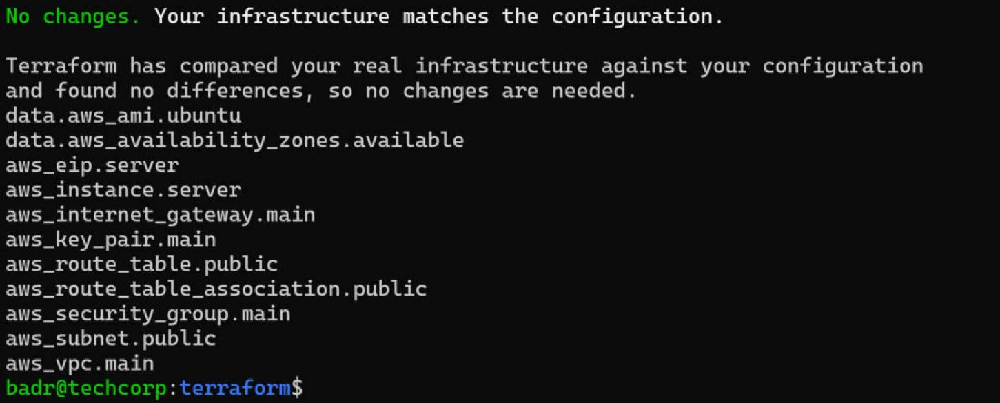
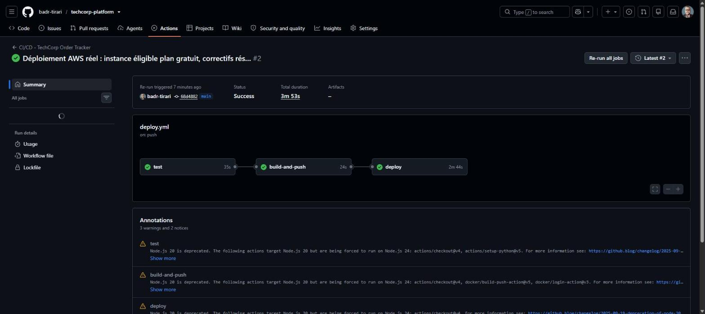
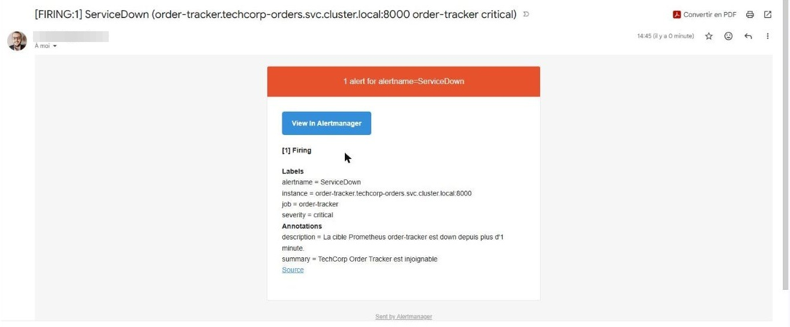

# techcorp-platform

Projet unique servant de support aux **3 CCP du Titre Professionnel Administrateur
Système DevOps** (RNCP niveau 6 — Bachelor DevOps, Studi).

**Une seule infrastructure, une seule application, un seul pipeline** :
Terraform et Ansible provisionnent et sécurisent un serveur AWS et y installent une
plateforme Kubernetes légère (k3s) ; la CI/CD GitHub Actions y déploie en continu
l'application *TechCorp Order Tracker* (FastAPI + PostgreSQL) ; Prometheus, Grafana et
Alertmanager supervisent cette même application et remontent une alerte par e-mail en
cas de dépassement de seuil.

> Déploiement réel effectué le **5 novembre 2026** sur AWS (eu-north-1), puis détruit
> (`terraform destroy`). Toutes les preuves sont dans [`docs/screenshots/`](docs/screenshots/).

| CCP | Compétence | Ce qui la démontre dans ce projet |
|---|---|---|
| **CCP1** | Automatiser le déploiement d'une infrastructure dans le cloud | `terraform/` (VPC, sous-réseau, IGW, groupe de sécurité, EC2, IP élastique) · `ansible/harden.yml` (durcissement ANSSI) · `ansible/bootstrap_k3s.yml` (plateforme de production) |
| **CCP2** | Déployer en continu une application | `app/` (FastAPI + PostgreSQL) · `tests/` · `.github/workflows/deploy.yml` (test → build → deploy) · `k8s/` (Deployment, PVC, Secret, Ingress, rolling update) · `ansible/github_runner.yml` |
| **CCP3** | Superviser les services déployés | `monitoring/` (Prometheus, 4 règles d'alerte, Alertmanager → e-mail, dashboard Grafana provisionné) |

## Architecture

```
                         Internet
                            │
              [Terraform : VPC 10.42.0.0/16, IGW, SG]
              SG : 80/443 publics · 22/6443/3000 IP admin uniquement
                            │
          ┌───────────────────────────────────────┐
          │  EC2 m7i-flex.large · Ubuntu 22.04    │ <- Ansible : durcissement ANSSI
          │  UFW (deny incoming) · fail2ban       │    (défense en profondeur :
          │  ┌─────────────────────────────────┐  │     SG AWS + UFW)
          │  │ k3s (Kubernetes)                │  │
          │  │  ns techcorp-orders             │  │ <- CI/CD : runner GitHub
          │  │   · order-tracker ×2 (rolling)  │  │    auto-hébergé (connexion
          │  │   · postgres + PVC 1 Gi         │  │    sortante, API k3s fermée
          │  │   · Ingress Traefik :80         │  │    à Internet)
          │  │  ns monitoring                  │  │
          │  │   · prometheus · alertmanager   │  │ -> alerte e-mail (SMTP Gmail)
          │  │   · grafana :3000               │  │
          │  └─────────────────────────────────┘  │
          └───────────────────────────────────────┘
```

## Pipeline CI/CD

```
push sur main ──► test (GitHub, docker compose + pytest)
               ──► build-and-push (image GHCR taguée par SHA du commit)
               ──► deploy (runner auto-hébergé sur l'EC2 : kubectl apply + rolling update)
```

## Supervision — règles d'alerte

| Alerte | Condition | Délai |
|---|---|---|
| `ServiceDown` | `up{job="order-tracker"} == 0` | 1 min |
| `HighErrorRate` | taux de réponses 5xx > 5 % | 2 min |
| `HighLatency` | latence P95 > 300 ms | 2 min |
| `DatabaseUnreachable` | échecs de connexion PostgreSQL | 1 min |

### Incident contrôlé (5 novembre 2026)

| Heure | Événement |
|---|---|
| 14:43:23 | Arrêt volontaire de PostgreSQL (`kubectl scale --replicas=0`) |
| 14:45 | Alerte `ServiceDown` en *firing* · e-mail `[FIRING:1]` reçu (détection ≈ 2 min) |
| 14:47:26 | Rétablissement de PostgreSQL |
| 14:50 | E-mail `[RESOLVED]` reçu · 4 règles revenues à *Normal* |

Pendant l'incident, Kubernetes a redémarré automatiquement les pods applicatifs
(liveness probe) ; les données ont été conservées grâce au volume persistant.

## Sécurité

- Accès d'administration (SSH, API k3s) restreint à l'IP admin **à deux niveaux** :
  groupe de sécurité AWS et pare-feu UFW.
- SSH par clé uniquement, connexion root interdite, `MaxAuthTries 3`, fail2ban.
- Paramètres noyau durcis (sysctl, recommandations ANSSI), mises à jour de sécurité automatiques.
- Disque EBS chiffré.
- Aucun secret versionné : identifiants PostgreSQL et Grafana en Secrets Kubernetes,
  configuration SMTP locale, `kubeconfig` / `tfstate` / `tfvars` exclus par `.gitignore`.
- Image applicative traçable : chaque version est taguée avec le SHA du commit.

## Démarrage

Voir **[RUNBOOK.md](RUNBOOK.md)** pour la procédure complète, étape par étape
(environ 20 minutes du `terraform init` à l'application supervisée).

## Captures (extrait)

| Infrastructure conforme au code | Pipeline CI/CD | Alerte reçue |
|---|---|---|
|  |  |  |

## Auteur

Badr-Eddine TIRARI — [github.com/badr-tirari](https://github.com/badr-tirari)
