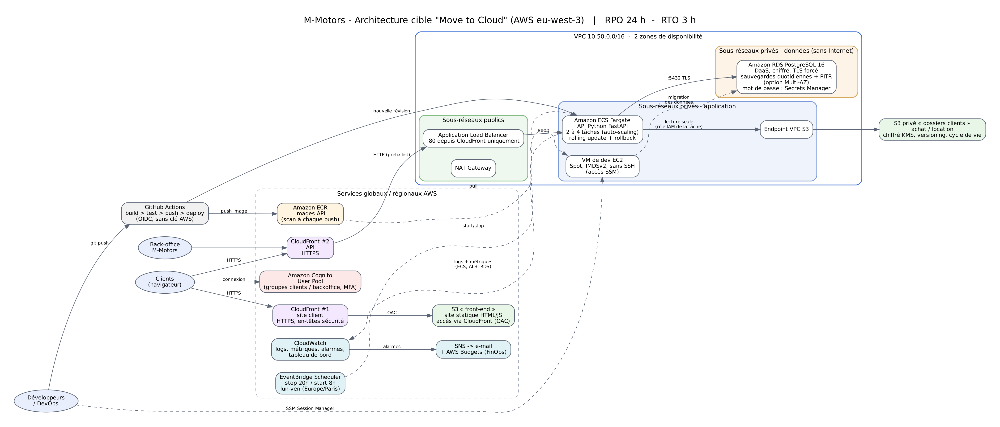

# ECF Final — M-Motors « Move to Cloud » (TP Administrateur Système DevOps)

Réponse technique à l'ECF Final Studi : refonte de l'application M-Motors
(achat + location longue durée) et hébergement sur AWS selon l'architecture
imposée par l'architecte. Le projet `techcorp-platform` (racine du dépôt) reste la
démonstration déjà déployée de bout en bout (k3s, GHCR, Prometheus/Grafana) ; ce
dossier ajoute l'architecture managée AWS demandée par l'énoncé.



## Correspondance énoncé → fichiers

| Question | Fichier(s) |
|---|---|
| AT1-Q1 Schéma d'architecture | `docs/architecture.png` (source `architecture.dot`) |
| AT1-Q2a S3 public (site statique) + S3 privé (dossiers) | `terraform/s3.tf`, `terraform/cloudfront.tf` |
| AT1-Q2b ECS | `terraform/ecs.tf`, `terraform/alb.tf`, `terraform/ecr.tf` |
| AT1-Q2c DaaS PostgreSQL | `terraform/rds.tf` |
| AT1-Q2d VM (spot + planifiée) | `terraform/dev_vm.tf` |
| AT1-Q3 Sécurisation | `terraform/security_groups.tf`, `network.tf`, `iam_s3_policy.tf`, `cognito.tf`, `github_oidc.tf` |
| AT2-Q1 FastAPI Hello World + « MY Test » | `app/main.py`, `tests/test_main.py` |
| AT2-Q2 Image Docker | `app/Dockerfile` |
| AT2-Q3 Push ECR | job `build-push` du pipeline |
| AT2-Q4 Pipeline build/test/deploy ECS | `../.github/workflows/ecf-mmotors-ecs.yml` |
| AT2-Q5 Policy lecture S3 depuis ECS | `terraform/iam_s3_policy.tf`, `policies/ecs-task-read-dossiers-s3.json` |
| AT3 Supervision + alerting | `terraform/monitoring.tf` |

## Déploiement

```bash
cd ecf-mmotors/terraform
cp terraform.tfvars.example terraform.tfvars   # renseigner alert_email
terraform init
terraform fmt -check && terraform validate
terraform plan -out=tfplan
terraform apply tfplan
```

Puis : confirmer l'abonnement SNS reçu par e-mail, créer la variable de dépôt
GitHub `AWS_ROLE_ARN` (output `github_actions_role_arn`) et lancer le workflow
*ECF M-Motors - CI/CD ECS* (il pousse l'image dans ECR et déploie sur ECS).

Destruction : `terraform destroy`.

## Tests en local

```bash
cd ecf-mmotors
pip install -r requirements-dev.txt
pytest -v
docker build -t mmotors-api app && docker run -p 8000:8000 mmotors-api
```
